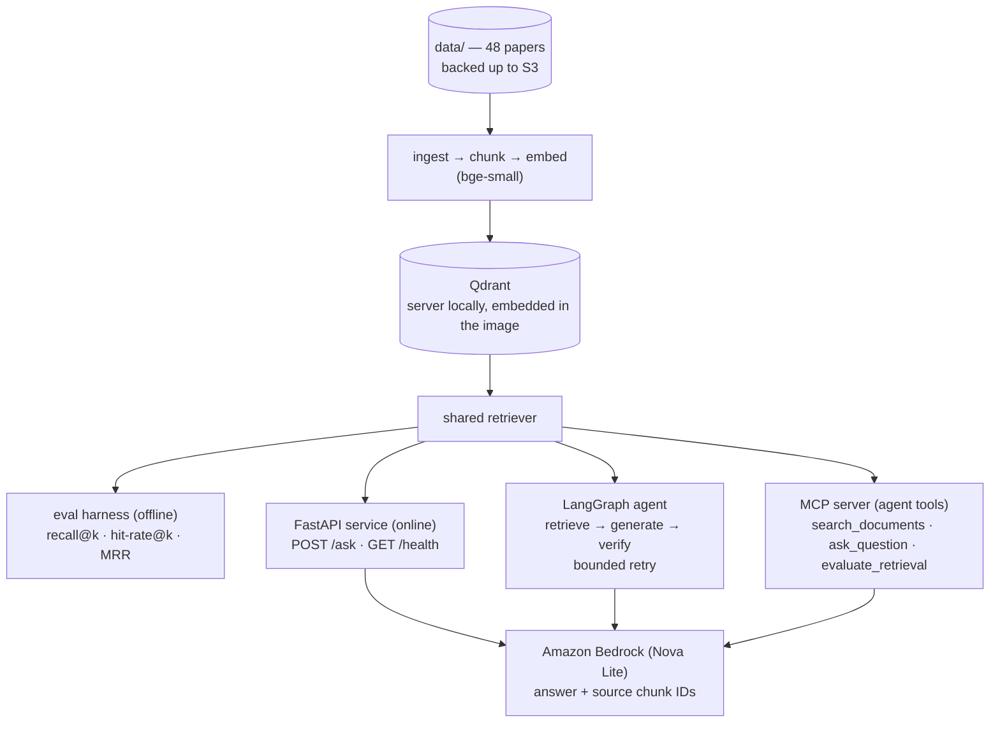
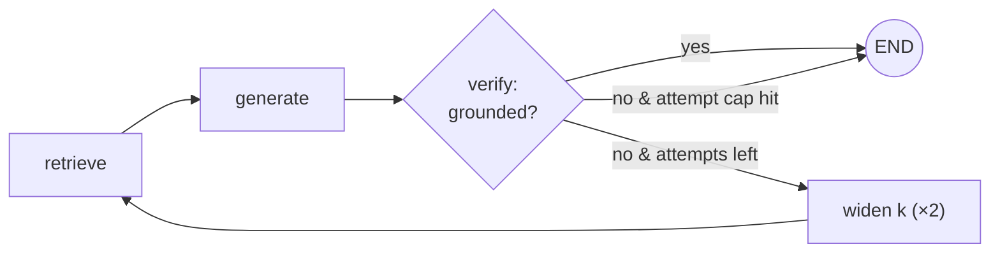

# RAG Evaluation Pipeline

**[Try it →](https://413de9svs9.execute-api.eu-central-1.amazonaws.com/)**  ·  deployed on AWS
Lambda in `eu-central-1`, answering from 48 papers with page-level citations.

Retrieval-augmented question answering over a corpus of NLP research papers (coreference
resolution and low-resource language modeling) — the kind of literature review this was
built to make searchable. A grounded question-answering backend and retrieval-evaluation
harness: ask a question, get an answer grounded in the source papers with citations.

The project is built around a **from-scratch retrieval evaluation harness**: the emphasis
is on *measuring* retrieval quality — recall@k, hit-rate@k, and MRR — rather than just
demonstrating that a RAG pipeline returns an answer.

48 papers are chunked, embedded with `bge-small-en-v1.5` and indexed in **Qdrant**, then
retrieved through a *single* path shared by the evaluation harness (offline) and the **FastAPI**
service (online) — so a retrieval improvement measured offline reaches production by construction,
not by convention. Answers are generated by **Amazon Bedrock** in `eu-central-1`, cited down to the
page. The pipeline is also exposed as **MCP tools** and orchestrated as a minimal **LangGraph**
agent, and ships as a container that runs Qdrant *embedded* — no database process, nothing billed
between requests.

## Retrieval results

Measured on a frozen, hand-verified set of **42 questions** (50 gold chunks spanning 37 of
the 48 papers, 1,688 chunks indexed). Recall@k is the fraction of relevant chunks found in
the top k; hit-rate@k is whether at least one relevant chunk is in the top k; MRR is the
mean reciprocal rank of the first relevant chunk.

| k   | recall@k | hit-rate@k |
|-----|----------|------------|
| 1   | 0.393    | 0.476      |
| 3   | 0.583    | 0.643      |
| 5   | 0.667    | 0.714      |
| 10  | 0.774    | 0.810      |
| 20  | 0.869    | 0.881      |
| 50  | 0.917    | 0.929      |
| 100 | 0.940    | 0.952      |

**MRR@10: 0.578.** MRR is truncated at the deepest k scored, so it is always quoted with its
depth — the same run reports 0.584 when k=100 is included.

### How the labels were made, and why it matters

The first ten questions were labelled by running a query through the retriever and choosing
gold chunks from its own top-k. That is circular: a chunk the retriever ranks 50th can never
become a label, so recall is measured against an answer key the retriever helped write, and
comes out too high.

The 32 questions added since are built the other way round. `scripts/sample_chunks.py` draws
chunks first — stratified per paper, references and acknowledgements skipped — and each
question is written from the sampled chunk without consulting the retriever at all. The
retriever never sees a label before it is scored on it. Drafts live in `evaluation/drafting/`
with the quoted line justifying each gold ID, so any label can be re-checked rather than
taken on trust.

### What the numbers say about what to build next

**Ranking is the main lever, but coverage is not solved.** recall@1 is 0.393 while recall@20
is 0.869: most relevant material *is* retrieved and simply ranked badly, which is what a
cross-encoder reranker fixes. That 48-point gap is the opportunity.

But recall@100 stops at **0.940**. Roughly 6% of gold chunks are unreachable at any practical
depth, and a reranker cannot recover them — they never enter the candidate pool. So hybrid
(dense + sparse) retrieval is no longer excluded on evidence; it has a target to beat, and
the reranker experiment must treat candidate-pool size as a measured parameter rather than
an assumption.

This replaces an earlier reading, taken from 10 questions, that coverage was fine and only
ranking needed work. Expanding the eval set contradicted it. The plan changed rather than
the measurement.

Reproduce with `python -m evaluation.run_eval`, or check against the committed baseline with
`python -m evaluation.compare_baseline`.

The metrics are implemented from scratch (`evaluation/eval_harness.py`) and verified against
hand-computed values, rather than imported from an evaluation library.

## Architecture



The retriever is a single shared component with four consumers — the offline evaluation
harness, the FastAPI service, the LangGraph agent, and the MCP server — so a change in
retrieval strategy is measured and exposed through one code path with no duplication. A
parity test (`tests/test_retrieval_parity.py`) fails if a second query site ever appears.

## Deployment


Everything is Terraform (`infra/`). The Qdrant index is built at image-build time and baked
in, so there is no database process and nothing billed between requests — the whole thing
costs roughly €0.50/month at rest.

**Two constraints shaped this, both discovered by deploying rather than by reading docs.**

*Lambda resource-based policies are not enforced on this account.* A SigV4-signed request
from a principal granted via `lambda:AddPermission` returns 403, while the same request from
a principal with an identity-based grant returns 200. That rules out a public Function URL
and also CloudFront with Origin Access Control, which signs as a service principal and is
authorised by exactly such a policy. API Gateway invokes Lambda through an **integration
role** instead, so authorisation runs through an identity policy. There is no
`aws_lambda_permission` anywhere in `infra/`, and that absence is the design.

*A cold `/ask` takes ~47s against a 30s gateway ceiling.* Loading torch and the embedding
model dominates; the ceiling is an AWS maximum, not a setting. An EventBridge schedule keeps
one container warm — pinging the retriever, not `/health`, which returns in 17.8s cold
precisely because it never loads the model. The demo page retries on 503 for the case a
schedule cannot cover: a second simultaneous visitor still gets a cold container.

| measured on the deployed service | |
|---|---|
| `/ask` warm | 0.4–1.1s |
| `/ask` cold | ~47s |
| cold start, 3008 MB | 18.7s |
| cold start, 2048 MB | 62.1s |

Cold start is CPU-bound, not memory-bound — peak usage is 970 MB. Lambda scales CPU with
memory, so the jump from 2048 to 3008 MB (this account's ceiling) buys cores, not RAM. The
honest fix is getting torch out of the request path by embedding queries through Bedrock;
the schedule is a mitigation, not a cure.

## Tech stack

- **Embeddings:** sentence-transformers (`BAAI/bge-small-en-v1.5`), runs on CPU
- **Vector store:** Qdrant, run as a Docker container (via `docker-compose`)
- **Generation:** Amazon Bedrock (`eu.amazon.nova-lite-v1:0`, region `eu-central-1`)
- **Corpus:** `data/`, gitignored and backed up to S3 by `scripts/backup_corpus.py`. 39 of the
  48 papers are re-fetchable from `scripts/corpus_manifest.csv`; the other 9 exist only there,
  so the bucket is versioned and the backup script can upload but never delete
- **API:** FastAPI + Uvicorn, adapted to Lambda with Mangum
- **Deployment:** Terraform — API Gateway (HTTP), Lambda container, ECR, EventBridge, Budgets
- **Agent layer:** MCP server (tools for AI agents) and a minimal LangGraph flow
- **Evaluation:** recall@k, hit-rate@k, MRR implemented from scratch

## Project structure

```
rag-eval-pipeline/
├── rag/
│   ├── config.py         # shared settings (collection, model, Qdrant endpoint)
│   ├── types.py          # Chunk: the currency between retrieval and everything downstream
│   ├── ingest.py         # load PDFs (S3 or local), chunk, attach page/section provenance
│   ├── build_index.py    # embed chunks and index them in Qdrant
│   ├── retriever.py      # the single retrieval path, used by eval and serving alike
│   ├── generate.py       # retrieve context and generate an answer via Bedrock
│   └── label_helper.py   # utility for building the eval set
├── api/
│   └── main.py           # FastAPI service: GET /health, POST /ask
├── evaluation/
│   ├── eval_harness.py   # recall@k / hit-rate@k / MRR, implemented from scratch
│   ├── eval_set.jsonl    # hand-labeled question → relevant chunk IDs
│   ├── baseline.json     # committed baseline the eval is compared against
│   ├── compare_baseline.py  # run the eval and diff it against the baseline
│   └── run_eval.py       # score the retriever against the eval set
├── mcp_server/
│   └── server.py         # MCP server: search, QA, and eval as agent tools
├── agent/
│   └── graph.py          # LangGraph flow: retrieve → generate → verify, bounded retry
├── scripts/
│   ├── corpus_manifest.csv  # the 39 fetched papers, with verified source URLs
│   └── fetch_corpus.py   # reproduce the corpus from the manifest
├── tests/                # metrics, chunk-ID stability, provenance, retrieval parity
├── docs/
│   ├── PROJECT_PLAN.md   # design rationale and scope
│   └── decisions/        # observation → decision → trade-off → measured validation
├── .githooks/pre-commit  # fast tests + a duplicate-key check, shared via core.hooksPath
├── docker-compose.yml    # runs the Qdrant container
└── pyproject.toml
```

## Setup

Requires Python 3.12+, Docker, and AWS credentials with access to an Amazon Bedrock model in
`eu-central-1`. S3 is optional — the corpus is read from `data/` unless `RAG_S3_BUCKET` is set.

```bash
python -m venv .venv
source .venv/bin/activate
pip install -e ".[dev]"
```

> If your checkout path contains spaces, invoke tools as `python -m uvicorn`, `python -m pytest`
> and so on. A shebang cannot express an interpreter path with a space in it, so the venv's
> console scripts will not run — the `-m` form is unaffected.

Start the Qdrant vector database (runs as a container; data persists in a named volume):

```bash
docker compose up -d
```

The Qdrant dashboard is then available at http://localhost:6333/dashboard.

Configure AWS credentials for a user with Bedrock invoke and S3 read permissions (e.g. in
`~/.aws/credentials`, region `eu-central-1`).

### The corpus

The PDFs are not in the repository — redistributing papers isn't ours to do — but the recipe is.
`scripts/corpus_manifest.csv` lists 39 open-access papers with verified source URLs, so the corpus
reproduces from a clone:

```bash
python scripts/fetch_corpus.py --dry-run   # review the list first
python scripts/fetch_corpus.py             # ~90s, polite rate limiting
```

Every URL in that manifest was checked by downloading the PDF and confirming the paper's own title
appears on page one, so a lookup that silently returned the wrong document could not get in.

Alternatively, point ingestion at S3 with `export RAG_S3_BUCKET=your-bucket-name`, or drop your own
PDFs into `data/`.

## Usage

```bash
# Start Qdrant (if not already running)
docker compose up -d

# 1. Verify documents load and chunk
python -m rag.ingest

# 2. Embed the chunks and build the Qdrant index
python -m rag.build_index

# 3. Score retrieval against the labeled eval set
python -m evaluation.run_eval

# 4. Serve the API (interactive docs at http://127.0.0.1:8000/docs)
python -m uvicorn api.main:app --reload
```

Ask a question through the API:

```bash
curl -X POST http://127.0.0.1:8000/ask \
  -H "Content-Type: application/json" \
  -d '{"question": "What is the BenCoref dataset?"}'
```

The response contains the generated `answer` and the `sources` (chunk IDs) it was drawn from.

## MCP server (agent tools)

The pipeline is also exposed as an [MCP](https://modelcontextprotocol.io) server, so
MCP-capable AI agents and clients can use it as a set of tools:

- `search_documents(query, k)` — search the corpus, returns ranked chunks
- `ask_question(question, k)` — grounded answer with source chunk IDs (via Bedrock)
- `evaluate_retrieval()` — score the retriever against the labeled eval set

Run it with the MCP Inspector for local testing (requires Node.js; Qdrant must be running):

```bash
mcp dev mcp_server/server.py
```

## Agentic flow (LangGraph)

The pipeline can also run as a minimal LangGraph agent with a bounded
self-correction loop:



The verify node makes a second, cheap model call to judge whether the answer is
supported by the retrieved context. If not, the graph widens retrieval (k doubled)
and retries once before finishing — so an ungrounded answer triggers a corrective
action, but the loop is strictly bounded (`MAX_ATTEMPTS = 2`).

```bash
python -m agent.graph
```

## Evaluation methodology

Retrieval is scored across k = 1, 3, 5, 10 so that a retrieval problem (low recall@10) is
distinguishable from a ranking problem (good recall@10 but low recall@1 / MRR), and again at
k = 20, 50, 100 because those answer a different question: whether the gold chunk is
reachable at all. A reranker can only reorder what the retriever already returned, so
recall@100 is the ceiling on what reranking could ever recover. Recall@k
and hit-rate@k are reported separately on purpose: they coincide only when each question
has exactly one relevant chunk. The eval set is frozen before any comparison is run, so a
retrieval change is scored against an answer key that predates it.

42 questions is enough to rank two systems and not enough to trust small differences: one
question moves hit-rate by 2.4 points, and the committed baseline's ±3% tolerance is about
1.3 questions. Bootstrap confidence intervals are the next addition to the harness, and
they matter before any reranker comparison is believed.

See [`docs/PROJECT_PLAN.md`](docs/PROJECT_PLAN.md) for design rationale and what is
deliberately out of scope.

## Running the container

The image carries the index inside it, so there is no Qdrant to run:

```bash
python scripts/fetch_corpus.py     # the build needs data/ populated
docker build -t rag-eval-pipeline .   # ~9 min: it embeds the corpus
docker run -p 8000:8000 -v ~/.aws:/home/app/.aws:ro rag-eval-pipeline
```

Then open http://localhost:8000 for the query page, or POST to `/ask`.

`infra/` holds the Terraform for deploying it as a single AWS Lambda behind a Function URL:
no API Gateway, no load balancer, no vector database. Cost is bounded by reserved concurrency
rather than by hope — see `docs/decisions/007`.

## Design decisions

`docs/decisions/` records each non-obvious choice as observation → hypothesis → decision →
trade-off → measured validation. Nine so far; these are picked because they document
mistakes rather than successes:

| Record | What it documents |
|---|---|
| [001](docs/decisions/001-unified-retrieval-path.md) | Five places were issuing Qdrant queries, including the tool that picked the gold labels |
| [002](docs/decisions/002-corpus-from-the-bibliography.md) | Three resolver bugs that would have corrupted the corpus silently |
| [004](docs/decisions/004-provenance-and-the-48-paper-baseline.md) | Expanding 9 → 48 papers: recall@1 held, depth collapsed, and why that changes the next step |
| [006](docs/decisions/006-containerising-with-a-baked-index.md) | Two failures that only appeared when the container actually ran |
| [007](docs/decisions/007-deploying-to-lambda.md) | Why the runtime identity cannot deploy, and what the deploy identity may touch |
| [008](docs/decisions/008-a-non-circular-eval-set.md) | The gold labels were sourced from the retriever being graded, and what changed when they were not |
| [009](docs/decisions/009-what-deploying-taught-that-reading-did-not.md) | Eight deployment failures no amount of reading the config would have caught |

## License

MIT