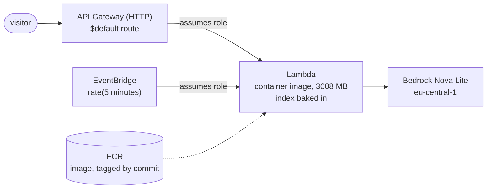
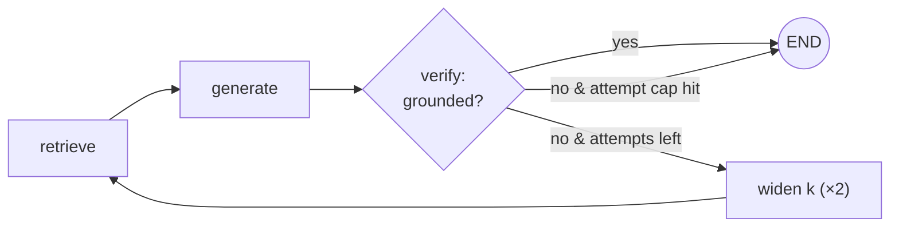

# RAG Evaluation Pipeline

**[Try it →](https://413de9svs9.execute-api.eu-central-1.amazonaws.com/)**  ·  deployed on AWS
Lambda in `eu-central-1`, answering from 48 papers with page-level citations.

Retrieval-augmented question answering over a corpus of NLP research papers (coreference
resolution and low-resource language modeling) — the kind of literature review this was
built to make searchable. A grounded question-answering backend and retrieval-evaluation
harness: ask a question, get an answer grounded in the source papers with citations.

The project is built around a **from-scratch evaluation harness**: the emphasis is on
*measuring* retrieval and answer quality — recall@k, hit-rate@k, MRR, nDCG with bootstrap
intervals, and hand-labelled faithfulness — rather than demonstrating that a RAG pipeline returns
an answer.

48 papers are chunked, embedded with `bge-small-en-v1.5` and indexed in **Qdrant**, then
retrieved through a *single* path shared by the evaluation harness (offline) and the **FastAPI**
service (online) — so a retrieval improvement measured offline reaches production by construction,
not by convention. Answers are generated by **Amazon Bedrock** in `eu-central-1`, cited down to the
page. The pipeline is also exposed as **MCP tools**, and ships as a container that runs Qdrant
*embedded* — no database process, nothing billed between requests. Every request is logged and
traced, and every pull request is gated on retrieval quality.

## Status: v1.0 — finished

This is complete, deliberately. It was built in four locked milestones with a stated finish line,
and it has reached it; new ideas go to the [backlog](#backlog), not into the code.

| Definition of done | Evidence |
|---|---|
| Publicly deployed RAG over the paper corpus | [live demo](https://413de9svs9.execute-api.eu-central-1.amazonaws.com/), AWS Lambda + API Gateway, Terraform in `infra/` |
| Reproducible retrieval evaluation | frozen 42-question set, metrics from scratch, bootstrap intervals — [below](#retrieval-results) |
| Human-validated faithfulness evaluation | 30 answers labelled by hand; an LLM judge measured and rejected — [012](docs/decisions/012-the-judge-detects-falsehood-not-unsupportedness.md) |
| Production tracing | one JSON log line per request + Langfuse traces, joined by request ID — [013](docs/decisions/013-one-log-line-per-request.md), [014](docs/decisions/014-tracing-that-cannot-cost-an-answer.md) |
| Automated quality-regression checks | every PR scored against the baseline in CI — [016](docs/decisions/016-a-retrieval-gate-without-the-corpus.md) |
| Measured latency and cost | ~0.5–1s warm, ~$0.0002 per question — [deployment](#deployment) |
| One evidence-driven retrieval experiment | two, both measured and not shipped: reranking ([010](docs/decisions/010-the-reranker-works-and-is-not-worth-shipping.md)), hybrid BM25 ([015](docs/decisions/015-hybrid-retrieval-and-the-eval-set-that-favoured-it.md)) |

What the numbers can and cannot support is under [known limitations](#known-limitations).

## Retrieval results

Measured on a frozen, hand-verified set of **42 questions** (50 gold chunks spanning 37 of
the 48 papers, 1,688 chunks indexed). Recall@k is the fraction of relevant chunks found in
the top k; hit-rate@k is whether at least one relevant chunk is in the top k; MRR is the
mean reciprocal rank of the first relevant chunk.

| k   | recall@k | hit-rate@k | nDCG@k | recall@k 95% CI  |
|-----|----------|------------|--------|------------------|
| 1   | 0.393    | 0.476      | 0.476  | [0.262, 0.524]   |
| 3   | 0.583    | 0.643      | 0.527  | [0.440, 0.714]   |
| 5   | 0.667    | 0.714      | 0.564  | [0.536, 0.798]   |
| 10  | 0.774    | 0.810      | 0.598  | [0.655, 0.881]   |
| 20  | 0.869    | 0.881      | —      | —                |
| 50  | 0.917    | 0.929      | —      | —                |
| 100 | 0.940    | 0.952      | —      | —                |

**MRR@10: 0.578**, 95% CI [0.448, 0.705]. MRR is truncated at the deepest k scored, so it is
always quoted with its depth — the same run reports 0.584 when k=100 is included.

The intervals are percentile bootstrap over queries and they are **±0.13 wide**, an order of
magnitude more than the ±3% tolerance on the committed baseline. Those two numbers answer
different questions: the tolerance guards against a change in *this* measurement, the interval
says how much the figure depends on *which* 42 questions were asked. Two retrievers are therefore
compared on per-query differences (`bootstrap_delta_ci`), not by checking whether these overlap —
at this width they always will.

### How the labels were made, and why it matters

The first ten questions were labelled by running a query through the retriever and choosing
gold chunks from its own top-k. That is circular: a chunk the retriever ranks 50th can never
become a label, so recall is measured against an answer key the retriever helped write, and
comes out too high.

The 32 questions added since are built the other way round. `scripts/sample_chunks.py` draws
chunks first — stratified per paper, references and acknowledgements skipped — and each
question is written from the sampled chunk without consulting the retriever at all. The
retriever never sees a label before it is scored on it. Drafts live in `evaluation/drafting/`
with the quoted line justifying each gold ID, so any label can be re-checked rather than
taken on trust.

### What the numbers suggested, and what came of it

recall@1 is 0.393 while recall@20 is 0.869: most relevant material *is* retrieved and ranked
badly, which pointed at reranking. recall@100 stops at 0.940: ~6% of gold chunks are unreachable
at any depth, which pointed at hybrid retrieval for coverage. Both were built and measured against
these numbers, below. Neither shipped, for different reasons, and the coverage gap remains.

This replaced an earlier reading, taken from 10 questions, that coverage was fine and only
ranking needed work. Expanding the eval set contradicted it. The plan changed rather than
the measurement.

### Answer faithfulness: measured by hand, because the judge failed

Retrieval metrics cap what the system can do; they say nothing about whether the answer is true to
what was retrieved. Thirty answers were generated by the real pipeline and labelled by hand —
before any judge ran, against the exact passages the model saw.

**3 of 30 answers were unfaithful: 10%, 95% CI [0.00, 0.23].**

| | answers | unfaithful |
|---|---|---|
| retrieval surfaced a relevant chunk | 21 | **0** |
| retrieval surfaced nothing relevant | 9 | **3 (33%)** |

The generator never fabricated when given correct evidence. Every unfaithful answer followed a
retrieval failure, so on this corpus faithfulness is downstream of retrieval — the lever is
retrieval quality, not prompt engineering.

An LLM judge was built to automate this and **does not work**: 83% agreement against a 90%
always-grounded baseline, Cohen's kappa −0.09, and it caught 0 of the 3 unfaithful answers while
catching 5 of 5 deliberately planted fabrications. It detects *falsehood*, not *unsupportedness* —
the real failures are plausible true statements that simply are not in the passages, and a judge
sharing the generator's knowledge marks those as supported. A stronger model did not help, which
rules out capability as the cause. See
[decision 012](docs/decisions/012-the-judge-detects-falsehood-not-unsupportedness.md).

### Reranking: measured, and deliberately not shipped

A cross-encoder (`bge-reranker-base`) reorders the dense candidates. The hypothesis was written
down before the run: ranking looked like the bottleneck, so reordering should help.

| candidate pool | recall@10 after rerank | ceiling (dense recall@pool) | ms/query |
|---|---|---|---|
| 10 | 0.774 | 0.774 | 8,309 |
| **20** | **0.869** | **0.869** | 15,781 |
| 50 | 0.857 | 0.917 | 41,052 |
| 100 | 0.821 | 0.940 | 84,693 |

At pool 20 it is perfect — 0.869 is exactly dense recall@20, so every gold chunk reachable in the
top 20 was pulled into the top 10. The hypothesis holds. Then quality *falls* as the pool grows
even though the ceiling rises: more candidates means more plausible-but-wrong passages to promote.

The one interval clearing zero in the whole sweep is pool 20's recall@10, **+0.095, 95% CI
[+0.024, +0.190]**. Twenty intervals were computed, so about one false positive is expected by
chance; what argues for a real effect is that nearly every delta at every pool is positive.

**It is not deployed.** 15.8s/query is 132× dense against a 30s gateway ceiling, to buy an
improvement 42 questions cannot firmly establish — and it cannot touch the ~6% of gold chunks
dense retrieval never reaches, which is the coverage problem that remains. See
[decision 010](docs/decisions/010-the-reranker-works-and-is-not-worth-shipping.md).

### Hybrid dense + BM25: a clear win that did not survive rewording

BM25 (written out, textbook parameters fixed before measuring) fused with dense by Reciprocal Rank
Fusion. On the eval set as written it is clearly better at the depths that ship — recall@4
**+0.153, 95% CI [+0.028, +0.292]**, recall@5 +0.167, nDCG@10 +0.091 — for +43ms per query.

But every eval question was written while reading its gold chunk, and **53%** of a question's
distinctive words appear in that chunk. BM25 is rewarded for exactly that, and a visitor has not
read the passage. So the questions were reworded by a model under fixed rules, reviewed by hand
(6 of 42 excluded for drifting in meaning, not repaired), and scored again against the same
labels. Overlap fell to 32%, and the hybrid's advantage at k = 4 fell to **+0.028, CI [−0.111,
+0.167]**: indistinguishable from zero. BM25 alone collapsed (MRR 0.477 → 0.316); dense held
(0.508 → 0.462).

**It is not deployed.** The evidence for it depends on how the questions were worded, and it
would push two of the demo page's examples down from rank 1. The code stays, tested, for the day
real visitor questions — which Langfuse now records — can settle it. See
[decision 015](docs/decisions/015-hybrid-retrieval-and-the-eval-set-that-favoured-it.md).

The same test says something about every number above: **the eval set flatters dense too**
(recall@5 0.625 as written, 0.542 reworded, on the same 36 questions). It stays frozen as a
regression baseline, which it does well; it is an optimistic estimate of absolute quality.

**Every pull request is gated on these numbers.** CI rebuilds the index from a 2.4 MB snapshot
of chunk IDs and vectors — no corpus, no AWS credentials, none of the papers' text in a public
repository — and fails if any metric drops more than 0.03 below the baseline. It reproduces the
baseline exactly, and fails an injected query bug on 11 of 13 metrics. See
[decision 016](docs/decisions/016-a-retrieval-gate-without-the-corpus.md).

Reproduce with `python -m evaluation.run_eval`, compare retrievers with
`python -m evaluation.compare_retrievers --pool 20` or `--system hybrid`, test robustness to
rewording with `python -m evaluation.robustness`, or check against the committed baseline with
`python -m evaluation.compare_baseline`.

The metrics are implemented from scratch (`evaluation/eval_harness.py`) and verified against
hand-computed values, rather than imported from an evaluation library.

## Architecture


The retriever is a single shared component with four consumers — the offline evaluation
harness, the FastAPI service, the LangGraph agent, and the MCP server — so a change in
retrieval strategy is measured and exposed through one code path with no duplication. A
parity test (`tests/test_retrieval_parity.py`) fails if a second query site ever appears.

## Deployment



Everything is Terraform (`infra/`). The Qdrant index is built at image-build time and baked
in, so there is no database process and nothing billed between requests — the whole thing
costs roughly €0.50/month at rest.

**Two constraints shaped this, both discovered by deploying rather than by reading docs.**

*Lambda resource-based policies are not enforced on this account.* A SigV4-signed request
from a principal granted via `lambda:AddPermission` returns 403, while the same request from
a principal with an identity-based grant returns 200. That rules out a public Function URL
and also CloudFront with Origin Access Control, which signs as a service principal and is
authorised by exactly such a policy. API Gateway invokes Lambda through an **integration
role** instead, so authorisation runs through an identity policy. There is no
`aws_lambda_permission` anywhere in `infra/`, and that absence is the design.

*A cold `/ask` took ~47s against a 30s gateway ceiling; it now takes ~20s.* Loading torch and
the embedding model dominates, and the ceiling is an AWS maximum, not a setting. Two fixes found
during release hardening closed most of the gap ([017](docs/decisions/017-a-cold-start-that-failed-before-it-began.md)):
importing the handler cost 15.5s against Lambda's 10s init limit, so **every cold start was an
init timeout** that threw 10s away and ran again; and each model load asked Hugging Face whether
the baked-in model had changed, a dependency that cost 63s of retries with no network. An
EventBridge schedule still keeps one container warm — pinging the retriever, not `/health`, since
only the retriever loads the model — and the demo page retries on 503 for a second simultaneous
visitor, who still gets a cold container.

| measured on the deployed service | |
|---|---|
| `/ask` warm | 0.5–1.2s |
| `/ask`, first request after a deploy | **19.8s** (was 25.1s, and ~47s when first deployed) |
| Lambda init phase | **2.1s** (was 10.0s, timing out every time) |
| cold start, 2048 → 3008 MB | 62.1s → 18.7s |
| peak memory | ~1,000 of 3,008 MB |

Cold start is CPU-bound, not memory-bound. Lambda scales CPU with memory, so the jump from 2048 to
3008 MB (this account's ceiling) buys cores, not RAM. The remaining fix is getting torch out of
the request path by embedding queries through Bedrock; it is in the [backlog](#backlog).

### When it fails

`/ask` never returns a bare 500. Bedrock is called with a connect and read timeout and a bounded
retry that botocore applies only to errors AWS marks retryable, and whatever escapes is classified
by whether trying again would help:

| What happened | Response |
|---|---|
| Throttled, timed out, service fault | **503** with `Retry-After` — the demo page retries behind "waking the model up" |
| Permission, validation, model not enabled | **502**, saying plainly that retrying will not help |
| Retrieval found nothing | **200** with "I could not find anything in the indexed papers" |

That last row is the grounding claim being honest: asking the model to answer from an empty
context is an invitation to invent one. Retrieval failures are deliberately *not* caught — a
broken index is a deployment fault, and masking it would hide the one thing worth paging about.
Each path is covered by fault injection in `tests/test_failure_modes.py`, with no AWS involved.

Each request also leaves one JSON log line — stage timings, retrieved chunk IDs, tokens, retries,
and the Bedrock error code or traceback when it fails — keyed by the `X-Request-Id` returned to
the caller. A failure is diagnosed from the line rather than by reproducing it, which for a
throttle or a timeout is usually impossible; `infra/DEPLOY.md` has the queries.

Each question is also traced in Langfuse: the passages retrieval returned, the exact prompt, the
answer, tokens and cost, on one timeline. The trace ID is derived from the request ID, so the
same `X-Request-Id` finds both. Cost is estimated at AWS's list price for `eu-central-1` —
**about $0.0002 per question** (~2,500 input tokens) — and computed once, so the log line and the
trace cannot disagree. Tracing is off without keys, and a slow Langfuse costs a trace, never an
answer: the flush before Lambda freezes is capped at 1s and counted in the gateway budget test.

## Tech stack

- **Embeddings:** sentence-transformers (`BAAI/bge-small-en-v1.5`), runs on CPU
- **Vector store:** Qdrant — a Docker container locally, embedded in the deployed image
- **Generation:** Amazon Bedrock (`eu.amazon.nova-lite-v1:0`, region `eu-central-1`)
- **Corpus:** `data/`, gitignored and backed up to S3 by `scripts/backup_corpus.py`. 39 of the
  48 papers are re-fetchable from `scripts/corpus_manifest.csv`; the other 9 exist only there,
  so the bucket is versioned and the backup script can upload but never delete
- **API:** FastAPI + Uvicorn, adapted to Lambda with Mangum
- **Deployment:** Terraform — API Gateway (HTTP), Lambda container, ECR, EventBridge, Budgets,
  SSM Parameter Store for the tracing keys
- **Observability:** structured JSON logs to CloudWatch, Langfuse tracing with per-request cost
- **CI:** GitHub Actions — lint, 107 tests, and a retrieval regression gate
- **Agent layer:** MCP server (tools for AI agents); a LangGraph flow kept as a prototype
- **Evaluation:** recall@k, hit-rate@k, MRR, nDCG, percentile and paired bootstrap, Cohen's kappa
  — all implemented from scratch

## Project structure

```
rag-eval-pipeline/
├── rag/
│   ├── config.py         # every setting: model, region, timeouts, prices, Qdrant endpoint
│   ├── types.py          # Chunk: the currency between retrieval and everything downstream
│   ├── ingest.py         # load PDFs (S3 or local), chunk, attach page/section provenance
│   ├── build_index.py    # embed chunks and index them; the one definition of the collection
│   ├── retriever.py      # the single retrieval path; BM25, hybrid and reranker as experiments
│   ├── generate.py       # retrieve context and generate an answer via Bedrock
│   ├── errors.py         # failures split by whether retrying helps
│   ├── telemetry.py      # one structured log line per request
│   ├── tracing.py        # Langfuse traces, off without keys, flush capped at 1s
│   └── label_helper.py   # utility for building the eval set
├── api/
│   ├── main.py           # FastAPI service and demo page: GET /, GET /health, POST /ask
│   └── lambda_handler.py # Mangum adapter, warm-up ping, trace flush
├── evaluation/
│   ├── eval_harness.py   # metrics and bootstrap intervals, implemented from scratch
│   ├── eval_set.jsonl    # frozen: 42 questions → gold chunk IDs, labelled chunk-first
│   ├── baseline.json     # the committed baseline every PR is gated against
│   ├── index_snapshot.npz  # chunk IDs + vectors, no text: CI's index
│   ├── compare_baseline.py # the regression gate
│   ├── compare_retrievers.py # paired comparison of retrieval systems
│   ├── robustness.py     # the same comparison on reworded questions
│   ├── faithfulness/     # 30 answers with human labels, and the judge's verdicts
│   └── judge.py          # the LLM judge that was measured and rejected
├── infra/                # Terraform, deploy policy, DEPLOY.md (deploy, smoke test, debugging)
├── mcp_server/server.py  # MCP server: search, QA, and eval as agent tools
├── agent/graph.py        # LangGraph prototype (see its section)
├── scripts/              # corpus fetch, verification, S3 backup, chunk sampling
├── tests/                # 107 tests: metrics, parity, failure injection, logging, tracing
├── docs/decisions/       # observation → decision → trade-off → measured validation
└── .github/workflows/ci.yml
```

## Setup

Requires Python 3.12+, Docker, and AWS credentials with access to an Amazon Bedrock model in
`eu-central-1`. S3 is optional — the corpus is read from `data/` unless `RAG_S3_BUCKET` is set.

```bash
python -m venv .venv
source .venv/bin/activate
pip install -e ".[dev]"
```

> If your checkout path contains spaces, invoke tools as `python -m uvicorn`, `python -m pytest`
> and so on. A shebang cannot express an interpreter path with a space in it, so the venv's
> console scripts will not run — the `-m` form is unaffected.

Start the Qdrant vector database (runs as a container; data persists in a named volume):

```bash
docker compose up -d
```

The Qdrant dashboard is then available at http://localhost:6333/dashboard.

Configure AWS credentials for a user with Bedrock invoke and S3 read permissions (e.g. in
`~/.aws/credentials`, region `eu-central-1`).

### The corpus

The PDFs are not in the repository — redistributing papers isn't ours to do — but the recipe is.
`scripts/corpus_manifest.csv` lists 39 open-access papers with verified source URLs, so the corpus
reproduces from a clone:

```bash
python scripts/fetch_corpus.py --dry-run   # review the list first
python scripts/fetch_corpus.py             # ~90s, polite rate limiting
```

Every URL in that manifest was checked by downloading the PDF and confirming the paper's own title
appears on page one, so a lookup that silently returned the wrong document could not get in.

Alternatively, point ingestion at S3 with `export RAG_S3_BUCKET=your-bucket-name`, or drop your own
PDFs into `data/`.

## Usage

```bash
# Start Qdrant (if not already running)
docker compose up -d

# 1. Verify documents load and chunk
python -m rag.ingest

# 2. Embed the chunks and build the Qdrant index
python -m rag.build_index

# 3. Score retrieval against the labeled eval set
python -m evaluation.run_eval

# 4. Serve the API (interactive docs at http://127.0.0.1:8000/docs)
python -m uvicorn api.main:app --reload
```

Ask a question through the API:

```bash
curl -X POST http://127.0.0.1:8000/ask \
  -H "Content-Type: application/json" \
  -d '{"question": "What is the BenCoref dataset?"}'
```

The response contains the generated `answer` and the `sources` (chunk IDs) it was drawn from.

## MCP server (agent tools)

The pipeline is also exposed as an [MCP](https://modelcontextprotocol.io) server, so
MCP-capable AI agents and clients can use it as a set of tools:

- `search_documents(query, k)` — search the corpus, returns ranked chunks
- `ask_question(question, k)` — grounded answer with source chunk IDs (via Bedrock)
- `evaluate_retrieval()` — score the retriever against the labeled eval set

Run it with the MCP Inspector for local testing (requires Node.js; Qdrant must be running):

```bash
mcp dev mcp_server/server.py
```

## Agentic flow (LangGraph)

The pipeline can also run as a minimal LangGraph agent with a bounded
self-correction loop:



The verify node makes a second, cheap model call to judge whether the answer is
supported by the retrieved context. If not, the graph widens retrieval (k doubled)
and retries once before finishing; the loop is strictly bounded (`MAX_ATTEMPTS = 2`).

**This is a prototype, and its central step is known not to work.** The verify node is an LLM
judging groundedness — exactly what decision 012 measured, with a stronger model and a stricter
prompt, and found worse than answering "grounded" every time. The agent is untested, not exposed
through the API, and kept as a sketch of the orchestration rather than a feature.

```bash
python -m agent.graph
```

## Evaluation methodology

Retrieval is scored across k = 1, 3, 5, 10 so that a retrieval problem (low recall@10) is
distinguishable from a ranking problem (good recall@10 but low recall@1 / MRR), and again at
k = 20, 50, 100 because those answer a different question: whether the gold chunk is
reachable at all. A reranker can only reorder what the retriever already returned, so
recall@100 is the ceiling on what reranking could ever recover. Recall@k
and hit-rate@k are reported separately on purpose: they coincide only when each question
has exactly one relevant chunk. The eval set is frozen before any comparison is run, so a
retrieval change is scored against an answer key that predates it.

42 questions is enough to rank two systems and not enough to trust small differences: one
question moves hit-rate by 2.4 points, and the committed baseline's ±3% tolerance is about
1.3 questions. That is why every comparison reports a bootstrap interval, and why the reranker
above is reported as a negative result despite moving every metric in the right direction.

[`docs/PROJECT_PLAN.md`](docs/PROJECT_PLAN.md) is the plan as written before any of this was
built, kept for the contrast; what is out of scope now is [below](#deliberately-out-of-scope).

## Running the container

The image carries the index inside it, so there is no Qdrant to run:

```bash
python scripts/fetch_corpus.py     # the build needs data/ populated
docker build -t rag-eval-pipeline .   # ~9 min: it embeds the corpus
docker run -p 8000:8000 -v ~/.aws:/home/app/.aws:ro rag-eval-pipeline
```

Then open http://localhost:8000 for the query page, or POST to `/ask`.

`infra/` holds the Terraform for deploying it as an AWS Lambda behind API Gateway — not a
Function URL, which cannot work on this account (see [Deployment](#deployment) and decision 009).
`infra/DEPLOY.md` has the deploy steps, the post-deploy smoke test, and how to investigate a
failed request.

## Known limitations

Each of these is measured or deliberately accepted, and each links to where.

- **The retrieval numbers are optimistic.** Every eval question was written while reading its
  gold chunk, and borrows its wording. Reworded the way a visitor would ask, dense recall@5 drops
  from 0.625 to 0.542 on the same questions ([015](docs/decisions/015-hybrid-retrieval-and-the-eval-set-that-favoured-it.md)).
  The set is a sound regression baseline and a generous estimate of absolute quality.
- **42 questions is small.** Absolute intervals are ±0.13 wide; one question moves recall@1 by
  0.024, inside the CI gate's ±0.03 tolerance. Comparisons are made on paired intervals for that
  reason, and several still could not settle a question.
- **Faithfulness rests on 30 answers labelled by one person.** 3 unfaithful, 95% CI [0.00, 0.23]
  — honest, and too wide to track a regression. No automated check replaces it: the judge that
  was built does not work ([012](docs/decisions/012-the-judge-detects-falsehood-not-unsupportedness.md)).
- **~6% of gold chunks are unreachable** at any retrieval depth. Neither reranking nor hybrid
  retrieval recovered them usefully.
- **Cold starts are close to the gateway's 30s ceiling.** A warm-up schedule covers one
  container; a second simultaneous visitor gets a cold one, and the page retries
  ([017](docs/decisions/017-a-cold-start-that-failed-before-it-began.md)). The account's
  Lambda concurrency limit is 10.
- **The model sometimes answers "You don't know." or prefixes "Answer:"**, because the system
  prompt says to "say you don't know". Left alone on purpose: the 30 faithfulness labels describe
  answers from this exact prompt, and changing it would leave them describing something no longer
  deployed.
- **Section names in citations are a heuristic** over extracted headings; page numbers are exact
  ([004](docs/decisions/004-provenance-and-the-48-paper-baseline.md)).
- **Cost is an estimate** at the eu-central-1 list price; the `eu.` inference profile may serve
  from another EU region ([014](docs/decisions/014-tracing-that-cannot-cost-an-answer.md)).
- **Traces leave AWS.** Each question, its passages and its answer go to Langfuse Cloud (EU).
  Client addresses are never logged or traced.

## Deliberately out of scope

- **Authentication and multiple users.** It is a public demo, bounded by a per-IP rate limit, the
  account's concurrency limit and a budget alarm.
- **GraphRAG, fine-tuning, further retrievers** (SPLADE, ColBERT, query rewriting). Two retrieval
  experiments were run to a decision; more would add surface without changing what the project
  demonstrates.
- **A larger eval set.** The useful next set is real visitor questions, not more written ones —
  see the backlog.
- **The LangGraph agent beyond a prototype**, given what 012 found about its verify step.
- **An automated post-deploy test**, which would need GitHub-to-AWS credentials; it is a
  [manual checklist](infra/DEPLOY.md#smoke-test-after-every-deploy) instead.
- **Streaming responses and multi-turn conversation.**

## Backlog

Ideas recorded so they are not lost, and so they do not leak into a finished project. None is
committed to.

- **Label real visitor questions** from the Langfuse traces, chunk-first as in 008. It is the
  unbiased eval set 015 calls for, and it would settle hybrid retrieval, whose code is already
  written and tested.
- **Embed queries through Bedrock** instead of a local model, taking torch out of the request
  path — the real fix for cold starts, at the cost of re-embedding the corpus and re-recording
  every baseline.
- **Fix the prompt's "You don't know." wording**, together with relabelling the faithfulness set.
- **An entailment-based faithfulness check** (an NLI model per claim and passage), which cannot
  fall back on world knowledge the way the LLM judge did.
- **Raise the account's Lambda concurrency limit** (support case open) and reserve concurrency.

## Design decisions

`docs/decisions/` records each non-obvious choice as observation → hypothesis → decision →
trade-off → measured validation. Seventeen so far; these are picked because they document
mistakes rather than successes:

| Record | What it documents |
|---|---|
| [001](docs/decisions/001-unified-retrieval-path.md) | Five places were issuing Qdrant queries, including the tool that picked the gold labels |
| [002](docs/decisions/002-corpus-from-the-bibliography.md) | Three resolver bugs that would have corrupted the corpus silently |
| [004](docs/decisions/004-provenance-and-the-48-paper-baseline.md) | Expanding 9 → 48 papers: recall@1 held, depth collapsed, and why that changes the next step |
| [006](docs/decisions/006-containerising-with-a-baked-index.md) | Two failures that only appeared when the container actually ran |
| [007](docs/decisions/007-deploying-to-lambda.md) | Why the runtime identity cannot deploy, and what the deploy identity may touch |
| [008](docs/decisions/008-a-non-circular-eval-set.md) | The gold labels were sourced from the retriever being graded, and what changed when they were not |
| [009](docs/decisions/009-what-deploying-taught-that-reading-did-not.md) | Eight deployment failures no amount of reading the config would have caught |
| [010](docs/decisions/010-the-reranker-works-and-is-not-worth-shipping.md) | The reranker does what it was predicted to do, and still should not ship |
| [011](docs/decisions/011-failures-that-say-whether-to-retry.md) | Classifying failures by whether retrying helps, and a retry budget that overran the ceiling it cited |
| [012](docs/decisions/012-the-judge-detects-falsehood-not-unsupportedness.md) | An LLM faithfulness judge that scored below a constant classifier, and what it was actually measuring |
| [013](docs/decisions/013-one-log-line-per-request.md) | A 503 that could not say why: one structured line per request, before any tracing |
| [014](docs/decisions/014-tracing-that-cannot-cost-an-answer.md) | Langfuse on Lambda: a flush the visitor waits for, capped and counted against the same 30s |
| [015](docs/decisions/015-hybrid-retrieval-and-the-eval-set-that-favoured-it.md) | A clear hybrid win that came from questions written beside their answers |
| [016](docs/decisions/016-a-retrieval-gate-without-the-corpus.md) | Gating every PR on retrieval quality from a text-free index snapshot |
| [017](docs/decisions/017-a-cold-start-that-failed-before-it-began.md) | Every cold start was an init timeout, and the demo depended on Hugging Face being up |

## License

MIT